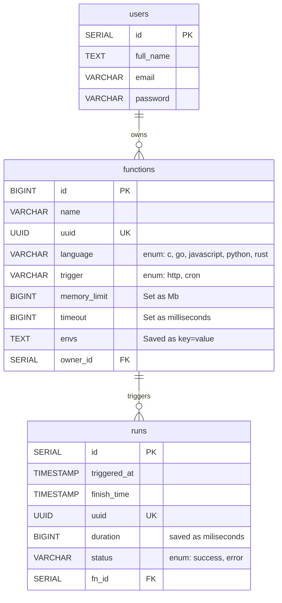

# Wambda: WASM-based FaaS runner

## Tools

- seaorm cli
- cargo
- npm/npx

## TODOs

- Add function to measure password strength ? [dropbox zxcvbn](https://github.com/shssoichiro/zxcvbn-rs)
- Add env vars encyption
- Add api keys table
- Add stats endpoints and queries
- Think of a way to pass requests and call http handlers
- Add sdks

## Notes to add in thesis (or future me)

- versions of wasmtime dependency have to match exactly or there are weird compile/type errors

## DB Schema

